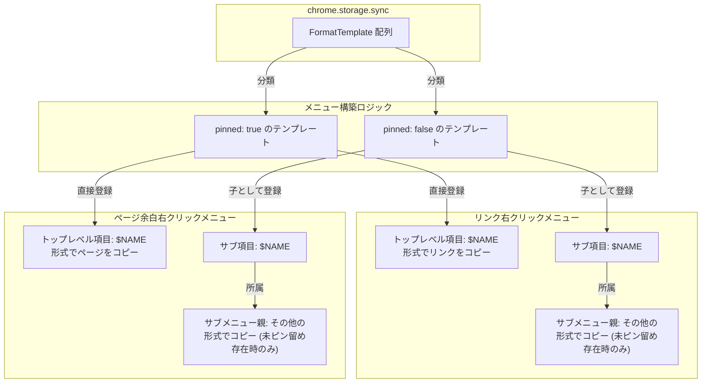
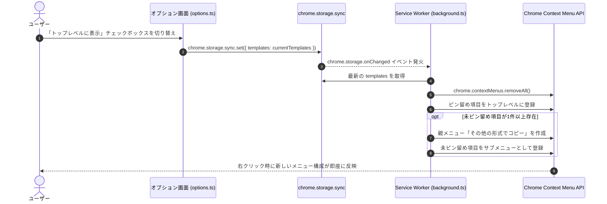

# データモデル設計書 (Data Model)

**機能ブランチ**: `001-pin-template-menus`  
**対象仕様書**: [spec.md](./spec.md)  
**作成日**: 2026-11-08  

---

## 1. 主要エンティティ

### 1.1 フォーマットテンプレート (`FormatTemplate`)

Webページ上のリンクまたはページ情報をクリップボードへコピーする際の書式と設定を保持するエンティティ。

| フィールド名 | 型 | 必須 | デフォルト値 | 説明 |
| :--- | :--- | :--- | :--- | :--- |
| `id` | `string` | 必須 | - | テンプレートの一意な識別子（例: `'markdown'`, `'slack'`, `'html'` 等） |
| `name` | `string` | 必須 | - | テンプレートの表示名（UIおよびメニュー表示用） |
| `format` | `string` | 必須 | - | 書式文字列（例: `'[${title}](${url})'`） |
| `mimeType` | `'text/plain' \| 'text/html'` | 任意 | `'text/plain'` | クリップボード書き込み時のMIME種別 |
| `pinned` | `boolean` | 任意 | `false` (Markdownのみ初期値 `true`) | **新規追加**: 右クリックメニューの第1階層（トップレベル）にピン留め表示するかどうかのフラグ |

#### バリデーションルール
- `id`: 空文字不可。英数字およびハイフンを推奨。
- `name`: 1文字以上の文字列。
- `format`: 1文字以上の文字列。
- `pinned`: 真偽値 (`boolean`)。未定義 (`undefined`) の場合は `isTemplatePinned()` ヘルパーにより `id === 'markdown'` を true、それ以外を false として評価する。

---

### 1.2 コンテキストメニュー項目 (`ContextMenuItemConfig`)

ブラウザのコンテキストメニューに登録される項目の動的構造を表す論理モデル。

| フィールド名 | 型 | 説明 |
| :--- | :--- | :--- |
| `id` | `string` | メニュー項目の一意な識別子（例: `'template:link:slack'`） |
| `title` | `string` | 画面に表示されるラベル文字列 |
| `contexts` | `('link' \| 'page' \| 'selection')[]` | メニューを表示するコンテキスト |
| `parentId` | `string \| undefined` | 親メニューのID（トップレベル項目の場合は未指定/undefined） |

---

## 2. エンティティ間の関連と階層構造

---

## 3. 状態遷移とデータフロー

### ピン留め状態の変更フロー

