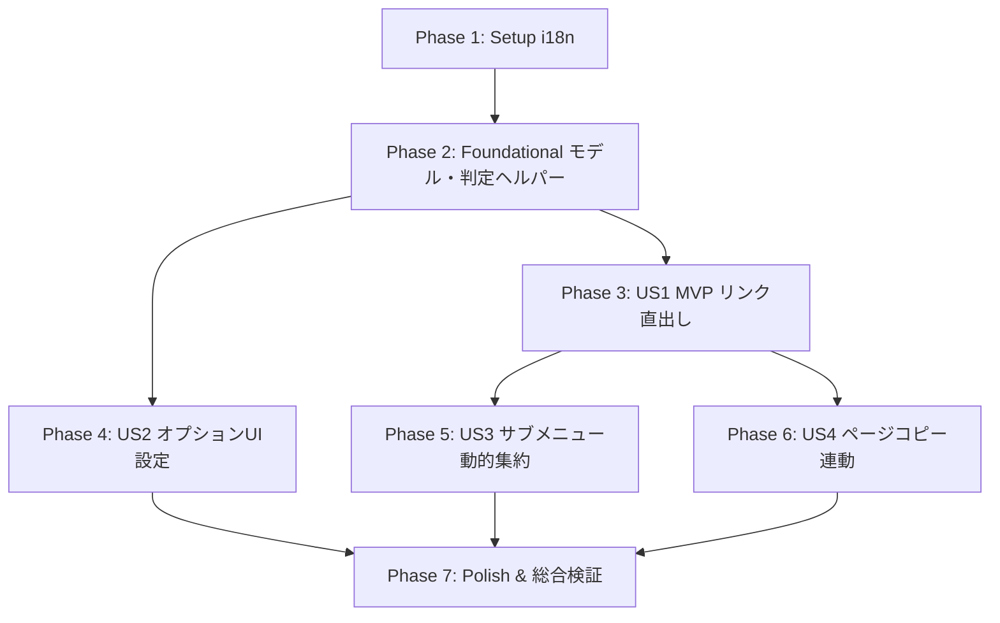

# タスク一覧: コンテキストメニュー第1階層へのテンプレートピン留め機能 (Tasks: Pin Templates to Context Menu)

**入力情報**: 設計成果物 (`specs/001-pin-template-menus/`)  
**前提条件**: [plan.md](./plan.md), [spec.md](./spec.md), [research.md](./research.md), [data-model.md](./data-model.md), [contracts/](./contracts/)  

## フォーマット: `- [ ] [TaskID] [P?] [Story?] 詳細な説明 (対象ファイルパス)`

- **[P]**: 並行実行可能（他タスクに依存せず、別ファイルを対象とする作業）
- **[Story]**: 対象ユーザーストーリー（US1, US2, US3, US4）
- すべてのタスクは対象ファイルパスを明記しています。

---

## Phase 1: Setup (共通リソースおよび国際化メッセージの定義)

**目的**: 本機能で必要となる多言語ラベルおよびメッセージ定義の準備

- [X] T001 [P] `package/_locales/ja/messages.json` にトップレベル表示用およびサブメニュー用の新規メッセージキー（`contextMenuCopyLinkAsFormat`, `contextMenuCopyPageAsFormat`, `contextMenuOtherFormatsLink`, `contextMenuOtherFormatsPage`, `thPinned`）を追加する
- [X] T002 [P] `package/_locales/en/messages.json` にトップレベル表示用およびサブメニュー用の新規メッセージキー（`contextMenuCopyLinkAsFormat`, `contextMenuCopyPageAsFormat`, `contextMenuOtherFormatsLink`, `contextMenuOtherFormatsPage`, `thPinned`）を追加する

---

## Phase 2: Foundational (データモデル拡張と後方互換性基盤)

**目的**: 全ユーザーストーリーの前提となるデータ構造の拡張と判定ヘルパーの実装

**⚠️ 重要**: 本フェーズ完了までユーザーストーリーの実装には進まないでください。

- [X] T003 `src/template.ts` の `FormatTemplate` インターフェースにオプショナルプロパティ `pinned?: boolean` を追加し、JSDocドキュメントコメントを記述する
- [X] T004 `src/template.ts` の `DEFAULT_TEMPLATES` 配列内の各要素に初期 `pinned` 値（Markdownのみ `pinned: true`、その他は `pinned: false`）を設定する
- [X] T005 `src/template.ts` にテンプレートのピン留め状態を判定するヘルパー関数 `isTemplatePinned(template: FormatTemplate): boolean` を実装し、未指定時の後方互換性フォールバック（`id === 'markdown'` を true と判定）を提供する

**チェックポイント**: 型定義と判定ロジックが整い、各機能の実装へ進める状態

---

## Phase 3: User Story 1 - よく使う形式をワンクリックでコピーする (Priority: P1) 🎯 MVP

**ゴール**: リンク右クリックメニューの第1階層にピン留めされた形式（例: Slack等）が直接表示され、サブメニューを開かずにワンクリックでコピーできるようにする

**独立テスト方法**: 
リンクを右クリックした際、第1階層に「Markdown形式でリンクをコピー」およびピン留めされた形式が表示され、クリック時に正しい記法でクリップボードへコピーされることを確認する。

### 実装タスク (User Story 1)

- [X] T006 [US1] `src/background.ts` の `setupContextMenus()` において、テンプレート一覧から `isTemplatePinned()` が true のテンプレートを抽出し、リンク右クリック（`contexts: ['link']`）のトップレベル項目として登録するロジックを実装する
- [X] T007 [US1] `src/background.ts` の `chrome.contextMenus.onClicked` リスナーにおいて、トップレベルに配置された `template:link:${id}` のクリックイベントが正しく既存のコピー処理へディスパッチされることを確認・調整する

**チェックポイント**: ピン留めされた形式がリンクのトップレベルに表示され、1クリックでコピー可能な MVP が動作すること

---

## Phase 4: User Story 2 - 設定画面でトップレベル表示形式をカスタマイズする (Priority: P2)

**ゴール**: オプション画面でテンプレート一覧に「トップレベルに表示（ピン留め）」チェックボックス列を設け、ユーザーが自由にON/OFFを切り替えて即座に同期保存できるようにする

**独立テスト方法**: 
オプション画面を開き、テンプレート一覧テーブルにチェックボックス列が表示されていることを確認する。チェックの切り替え時に `chrome.storage.sync` が即時保存され、ステータスが表示されることを検証する。

### 実装タスク (User Story 2)

- [X] T008 [P] [US2] `package/options.html` のテンプレート一覧テーブル（`<table>`）の `<thead>` に「トップレベル表示」用の `<th>` 列（ID: `th-pinned`）を追加し、スタイリングを調整する
- [X] T009 [US2] `src/options.ts` の `renderTemplates()` 関数を改修し、各行にピン留め状態を反映したチェックボックス要素を生成・描画する処理を追加する
- [X] T010 [US2] `src/options.ts` にチェックボックスの `change` イベントリスナーを追加し、チェック状態に応じて `template.pinned` を更新して `saveTemplates()` を呼び出す処理を実装する
- [X] T011 [US2] `src/options.ts` の新規テンプレート追加処理およびデフォルト復元処理（`btn-reset-templates`）において、`pinned` プロパティが適切に初期化（新規追加は `false`、リセット時は初期プリセット値）されるよう更新する

**チェックポイント**: オプション画面から任意のテンプレートのピン留めを切り替え、設定が即座に反映されること

---

## Phase 5: User Story 3 - ピン留めしなかった形式もサブメニューから利用できる (Priority: P3)

**ゴール**: ピン留めされていないテンプレートを「その他の形式でコピー」サブメニューに自動集約し、全ピン留め時はサブメニューを非表示、全解除時はサブメニューのみ表示する制御を実現する

**独立テスト方法**: 
一部のみピン留めした場合に「その他の形式でコピー」サブメニュー内に未ピン留め項目のみが格納されること、全形式ピン留め時にサブメニューが消えること、全解除時にサブメニューのみになることを検証する。

### 実装タスク (User Story 3)

- [X] T012 [US3] `src/background.ts` の `setupContextMenus()` において、未ピン留め（`isTemplatePinned()` が false）のテンプレートが1件以上存在する場合のみ親メニュー `copy-link-as-template-parent`（タイトル: `contextMenuOtherFormatsLink`）を生成する条件分岐を実装する
- [X] T013 [US3] `src/background.ts` において、未ピン留めのテンプレートを親メニュー `copy-link-as-template-parent` の子メニューとして登録する処理を実装する
- [X] T014 [US3] `src/background.ts` において、すべてのテンプレートのピン留めが解除されている場合、トップレベルへの個別項目出力をスキップし、親メニューのみが第1階層に表示されるエッジケース制御を検証・調整する

**チェックポイント**: ピン留め項目と未ピン留め項目が分離され、サブメニューが過不足なく動的に制御されること

---

## Phase 6: User Story 4 - ページ全体のリンクコピーへの連動適用 (Priority: P3)

**ゴール**: リンクコピーと同様に、Webページの空白部分右クリック（`contexts: ['page']`）においてもピン留め形式を第1階層に直出しし、未ピン留め形式を「その他の形式でコピー」サブメニューに集約する

**独立テスト方法**: 
Webページの余白部分を右クリックした際、ピン留めされた形式が「[形式名]形式でページをコピー」として第1階層に並び、未ピン留め形式がサブメニューに格納されることを確認する。

### 実装タスク (User Story 4)

- [X] T015 [US4] `src/background.ts` の `setupContextMenus()` において、ページ余白右クリック（`contexts: ['page']`）向けにピン留めされたテンプレートをトップレベル項目（タイトル: `contextMenuCopyPageAsFormat`）として登録する処理を実装する
- [X] T016 [US4] `src/background.ts` において、ページ余白右クリック向けに未ピン留めテンプレートが存在する場合のみ親メニュー `copy-page-as-template-parent`（タイトル: `contextMenuOtherFormatsPage`）を生成し、子項目として登録する処理を実装する
- [X] T017 [US4] `src/background.ts` の `chrome.contextMenus.onClicked` において、トップレベルおよびサブメニューから呼び出された `template:page:${id}` のページコピー処理が正しく動作することを確認・調整する

**チェックポイント**: リンクコピーとページコピーの両方でピン留め設定が統一された操作性で動作すること

---

## Phase 7: Polish & Cross-Cutting Concerns (仕上げ・ドキュメント・総合検証)

**目的**: 仕様書ドキュメントの同期、ビルド成果物の確認、クイックスタートガイドに基づく網羅的検証

- [X] T018 [P] `docs/spec.md` を更新し、第1階層ピン留め機能、オプション画面のチェックボックス列、および多言語ラベル仕様をコア機能仕様書に反映する
- [X] T019 プロジェクトのビルド（`npm run build`）を実行し、TypeScriptコンパイルエラーおよびバンドルエラーがないことを確認する
- [X] T020 `specs/001-pin-template-menus/quickstart.md` の5つの検証シナリオ（デフォルト動作、ピン留め切替、全ピン留め、全解除、ページ連動）を実行し、全要件が満たされていることを総合検証する

---

## 依存関係および実行順序 (Dependencies & Execution Order)

### フェーズ依存関係

### 並行実行可能なタスク例
- **Phase 1**: `T001` (ja/messages.json) と `T002` (en/messages.json) は完全に並行可能
- **Phase 4**: `T008` (options.html) のUIマークアップ修正は `T006` や `T007` と並行して着手可能
- **Phase 7**: `T018` (docs/spec.md 更新) は実装完了前後に並行可能

---

## 実装戦略 (Implementation Strategy)

### 1. MVP の最短確立 (Phase 1 〜 Phase 3)
まずデータモデル（`pinned` プロパティ）と多言語メッセージを準備し、`background.ts` でピン留めされた形式がリンク右クリックのトップレベルに表示される最小限の動作品（MVP）を成立させます。

### 2. ユーザー設定機能の提供 (Phase 4)
オプション画面にチェックボックス列を追加し、ユーザー自身がピン留めを切り替えて即座にメニューへ反映される操作フローを完成させます。

### 3. サブメニュー動的制御とページコピー連動 (Phase 5 & 6)
未ピン留め形式の集約、全ピン留め/全解除時のエッジケース対応、およびページ余白右クリックへの連動を実装し、機能仕様を100%充足させます。

### 4. 総合検証とドキュメント同期 (Phase 7)
`quickstart.md` に沿った手動検証を行い、プロジェクト仕様書（`docs/spec.md`）を更新してリリース可能な状態に仕上げます。
