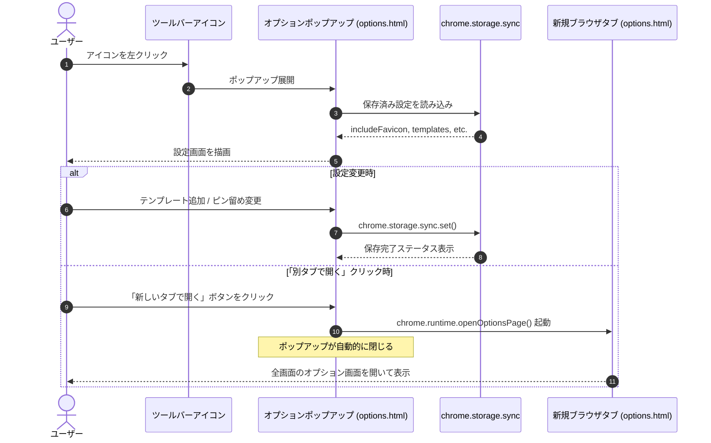

# データモデル仕様 (Phase 1: Data Model)

## 概要
本機能（`002-options-popup`）において扱われる設定データ構造、UI状態モデル、およびエンティティの相互関係を定義します。

---

## 1. エンティティ定義

### 1.1 Action Context (ツールバーアクション・コンテキスト)
ブラウザのツールバーに配置される拡張機能アクションの定義。

- **`default_popup`**: ポップアップとして読み込まれるHTMLファイルパス (`"options.html"`)。
- **`default_icon`**: ツールバー上で表示されるアイコン画像リソースのマップ。

### 1.2 View Context (オプション画面の表示モード)
オプション画面（`options.html`）が動作している環境コンテキスト。

| プロパティ名 | 型 | 説明 | 取り得る値 |
|---|---|---|---|
| `displayMode` | `string` | 画面の表示モード | `'popup'` (ツールバーポップアップ内) / `'tab'` (独立タブ・全画面) / `'inline'` (拡張機能管理埋め込み) |
| `canOpenTab` | `boolean` | 「別タブで開く」操作が可能かどうか | `displayMode === 'popup'` の場合 `true` |

### 1.3 User Settings (ユーザー設定データ - 永続化ストレージ)
`chrome.storage.sync` に保持されるデータモデル（既存データ構造をそのまま継承）。

| キー名 | 型 | デフォルト値 | 説明 |
|---|---|---|---|
| `includeFavicon` | `boolean` | `false` | リンク生成時にWebサイトのファビコン画像を含めるかどうか |
| `faviconSize` | `string` | `'16'` | ファビコンの画像サイズ（px単位: `'12'`, `'16'`, `'24'`, `'32'`） |
| `templates` | `FormatTemplate[]` | `DEFAULT_TEMPLATES` | 登録されているフォーマットテンプレートの配列 |
| `shortcutTemplateId` | `string` | `'markdown'` | キーボードショートカット実行時に適用するテンプレートのID |

### 1.4 FormatTemplate (フォーマットテンプレート)
`src/template.ts` に定義されているテンプレートエンティティ。

| フィールド | 型 | 必須 | 説明 |
|---|---|---|---|
| `id` | `string` | 必須 | テンプレートを一意に識別するID（例: `'markdown'`, `'html'`, `'custom-12345'`） |
| `name` | `string` | 必須 | テンプレートの表示名（例: `'Markdown'`, `'Rich Text (HTML)'`） |
| `format` | `string` | 必須 | 展開フォーマット文字列（例: `'[{{title}}]({{url}})'`） |
| `mimeType` | `ClipboardMimeType` | 任意 | クリップボード格納形式（`'text/plain'` または `'text/html'`） |
| `pinned` | `boolean` | 任意 | 右クリックコンテキストメニューのトップレベルにピン留め表示するかどうか |

---

## 2. 状態遷移とデータフロー

---

## 3. バリデーションルール

1. **テンプレート名・形式の必須入力**:
   - `name`: 1文字以上、トリム後の空文字禁止。
   - `format`: 1文字以上、トリム後の空文字禁止。
2. **テンプレート数の下限**:
   - 登録テンプレートが1件のみの場合、そのテンプレートを削除することはできない（最低1件の維持）。
3. **MIMEタイプの整合性**:
   - `mimeType` は `'text/plain'` または `'text/html'` のいずれかのみ許容。
