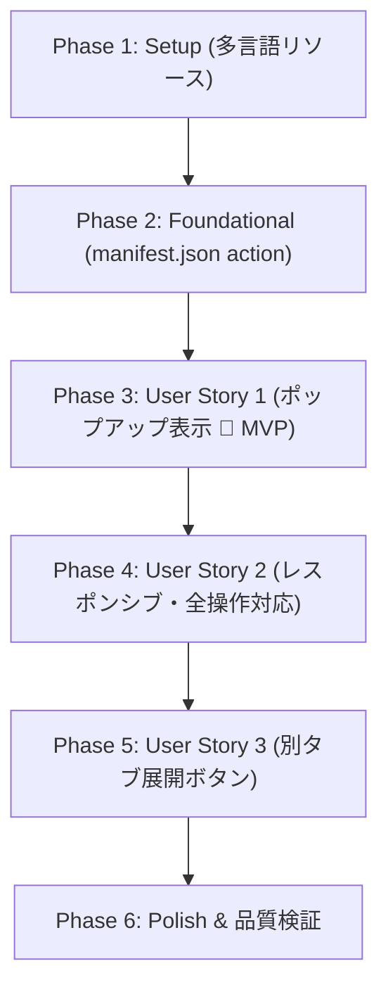

# Tasks: オプション画面のポップアップ表示 (002-options-popup)

**Input**: Design documents from `specs/002-options-popup/`
**Prerequisites**: [plan.md](plan.md), [spec.md](spec.md), [research.md](research.md), [data-model.md](data-model.md), [contracts/](contracts/)
**Organization**: タスクはユーザーストーリーごとに独立して実装・検証できるようにグループ化されています。

## フォーマット: `[ID] [P?] [Story] Description with file path`

- **[P]**: 並行実行可能（異なるファイル、未完了タスクへの依存なし）
- **[Story]**: 対象ユーザーストーリー（US1, US2, US3）
- 説明文には具体的なファイルパスを明記

---

## Phase 1: Setup (多言語リソースと基盤準備)

**目的**: 本機能で追加する「別タブで開く」操作ボタンのラベルおよび多言語メッセージを準備する。

- [ ] T001 [P] 多言語リソースファイルに「別タブで開く」用メッセージキー（optionsOpenInTab）を追加する in package/_locales/ja/messages.json
- [ ] T002 [P] 多言語リソースファイルに「別タブで開く」用英語メッセージキーを追加する in package/_locales/en/messages.json

---

## Phase 2: Foundational (コアインフラ・設定)

**目的**: ツールバーアイコンクリック時にポップアップを起動するためのManifest V3設定を行う。

**⚠️ CRITICAL**: このフェーズが完了するまでユーザーストーリーの実装は開始できません。

- [ ] T003 manifest.json に action 定義（default_popup: "options.html", default_icon, default_title）を追加する in package/manifest.json

**Checkpoint**: 拡張機能アイコンから options.html をポップアップとして起動可能になる。

---

## Phase 3: User Story 1 - ツールバーアイコンからのポップアップ表示 (Priority: P1) 🎯 MVP

**Goal**: ユーザーがツールバーの拡張機能アイコンをクリックした際に、options.html がポップアップとして正常に展開され、外側クリックで自動的に閉じる。

**Independent Test**: `npm run build` を実行後、Chromeのツールバーにある MdPicker アイコンをクリックしてオプション画面がポップアップ枠内に即座に表示されることを確認する。

### Implementation for User Story 1

- [ ] T004 [US1] options.html の body スタイルにポップアップ基準の幅（min-width: 480px; max-width: 540px;）および適切なパディングを適用する in package/options.html

**Checkpoint**: User Story 1 が単体で動作し、ツールバーアイコンからポップアップ表示が可能になる (MVP)。

---

## Phase 4: User Story 2 - ポップアップ内での全設定操作とレスポンシブ対応 (Priority: P1)

**Goal**: ポップアップの幅（480px〜540px）に適したレイアウトで全設定項目（ファビコン、テンプレート一覧、追加フォーム）を横スクロールなしで快適に操作でき、変更が即座にストレージへ保存・同期される。

**Independent Test**: ポップアップ内でテンプレート追加やピン留め設定、ファビコン設定を変更し、Webページの右クリックメニューへ即座に反映されることを確認する。

### Implementation for User Story 2

- [ ] T005 [P] [US2] テンプレート一覧テーブルのカラム幅比率（col-pinned, col-name, col-mimetype, col-format, col-actions）および折り返しスタイルをポップアップ向けに最適化する in package/options.html
- [ ] T006 [P] [US2] テンプレート追加フォーム（.add-form）に flex-wrap: wrap および入力要素のレスポンシブ幅スタイルを追加する in package/options.html
- [ ] T007 [US2] ポップアップ内での各入力イベントによる chrome.storage.sync への保存とステータス表示が正常に機能することを確認・調整する in src/options.ts

**Checkpoint**: ポップアップ内だけで既存のオプション機能がすべて完結して操作できるようになる。

---

## Phase 5: User Story 3 - ポップアップから広い画面（別タブ）でのオプション画面起動 (Priority: P2)

**Goal**: ポップアップのヘッダー領域に「別タブで開く」ボタンを配置し、クリック時に `chrome.runtime.openOptionsPage()` を呼び出して全画面ブラウザタブへ遷移できるようにする。

**Independent Test**: ポップアップ右上のボタンをクリックし、新しいブラウザタブとして全画面のオプション画面が開くことを確認する。

### Implementation for User Story 3

- [ ] T008 [US3] options.html の上部にヘッダーコンテナ（.options-header）、タイトル（#options-title）、および「別タブで開く」ボタン（#btn-open-tab）のマークアップとスタイルを追加する in package/options.html
- [ ] T009 [US3] options.ts に #btn-open-tab のクリックイベントリスナーを登録し chrome.runtime.openOptionsPage() を呼び出す処理を実装する in src/options.ts
- [ ] T010 [US3] options.ts の applyLocalization() に「別タブで開く」ボタンのツールチップ・アクセシビリティラベルの多言語適用を追加する in src/options.ts

**Checkpoint**: すべてのユーザーストーリー（US1, US2, US3）が完全に統合され、独立して検証可能になる。

---

## Phase 6: Polish & Cross-Cutting Concerns (品質検証と仕上げ)

**目的**: ビルドの検証、全シナリオの動作テスト、およびプロジェクト全体の仕様書の更新。

- [ ] T011 Webpackビルドを実行し TypeScript コンパイルエラーおよびバンドル出力を検証する in webpack.config.js
- [ ] T012 [P] quickstart.md の検証シナリオ（ポップアップ起動、設定変更、別タブ展開、既存メニュー互換）を実施する in specs/002-options-popup/quickstart.md
- [ ] T013 [P] プロジェクト全体の機能仕様書 docs/spec.md にポップアップ表示機能および manifest 設定の変更を反映する in docs/spec.md

---

## 依存関係と実行順序 (Dependencies & Execution Order)

### フェーズ間の依存関係

- **Phase 1 (Setup)**: 依存関係なし。即時着手可能。
- **Phase 2 (Foundational)**: Phase 1 完了後に実施。全ユーザーストーリーの前提条件。
- **Phase 3 (User Story 1)**: Phase 2 完了後に着手（MVP）。
- **Phase 4 (User Story 2)**: Phase 3 完了後に着手。
- **Phase 5 (User Story 3)**: Phase 4 完了後に着手。
- **Phase 6 (Polish)**: すべてのユーザーストーリー完了後に実施。

---

## 並行実行の機会 (Parallel Opportunities)

- **Phase 1**: T001（日本語）と T002（英語）は並行実行可能 `[P]`。
- **Phase 4**: T005（テーブルスタイル）と T006（フォームスタイル）は並行して編集・調整可能 `[P]`。
- **Phase 6**: T012（動作検証）と T013（ドキュメント更新）は並行実行可能 `[P]`。

---

## 実装戦略 (Implementation Strategy)

### MVPファーストアプローチ
1. **Phase 1〜3 を完了**:
   - `manifest.json` に `action` を追加し、アイコンクリックでポップアップが開く基本機能（MVP）を成立させる。
2. **Phase 4 でUIと操作性を向上**:
   - ポップアップ幅に最適化したテーブル表示と設定保存の安定化。
3. **Phase 5 で別タブ展開を追加**:
   - 広い画面での編集ニーズに対応するセーフティネットを提供。
4. **Phase 6 で最終検証と仕様同期**:
   - ビルドとE2E確認、仕様書の更新。
